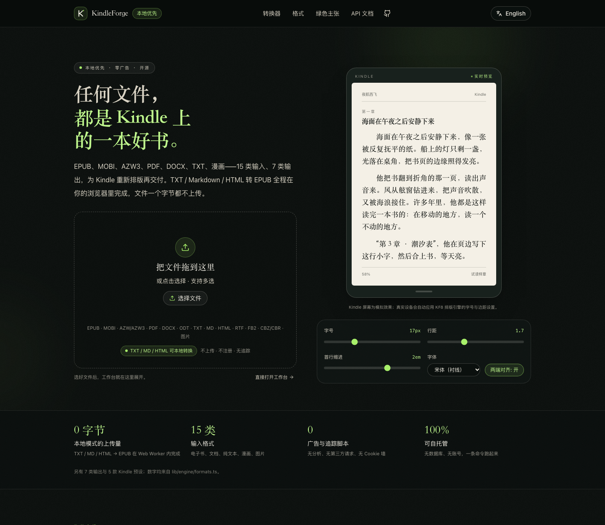
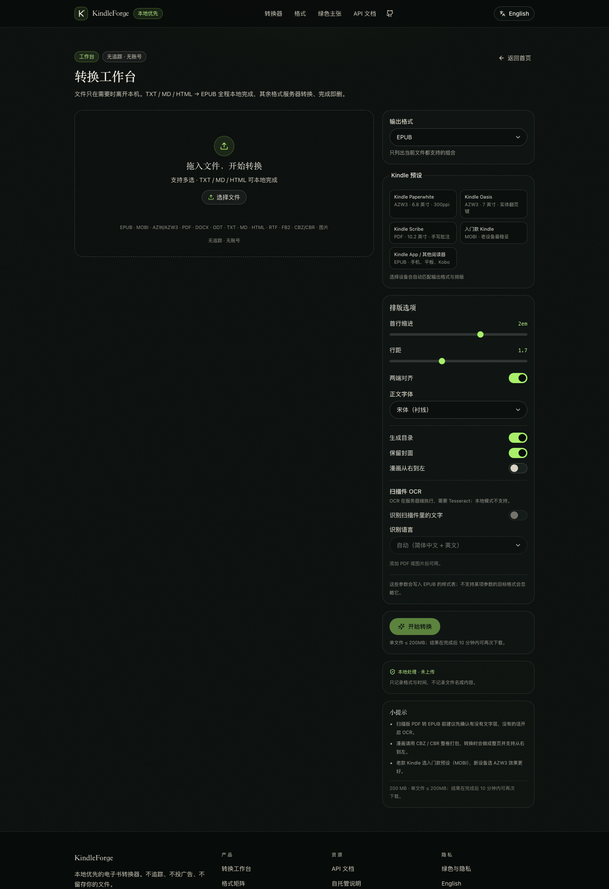

# KindleForge · 铸书

> 把任何一份文件，变成 Kindle 上最好读的那本书。
> Any file, forged into the book it deserves to be on Kindle.

**本地优先 · 零上传 · 无广告 · 开源可自托管**

KindleForge 是一个电子书转换站：EPUB / MOBI / AZW3 / PDF / DOCX / TXT / Markdown / HTML / FB2 / CBZ / CBR / 图片……互相转换，并且**专门为 Kindle 与电子墨水屏做排版优化**。



<p align="center"><em>落地页：真实可用的拖拽上传 + Kindle 屏实时排版预览，滚动条上方是「0 字节上传 / 15 类输入 / 0 追踪 / 100% 可自托管」。</em></p>

---

## 为什么不是又一个在线转换器

| | RunConvert | KindleForge |
|---|---|---|
| 文本格式转换 | 上传到云端处理 | **在浏览器里完成，文件不上传**（TXT/MD/HTML → EPUB，可断网） |
| 文件留存 | 1 小时后删除 | 任务完成即删，临时目录 + 10 分钟 TTL，无数据库 |
| 追踪/广告 | 有广告 | 无广告、无分析脚本、无第三方请求 |
| Kindle 排版 | 格式转换 | 中文首行缩进/标点/行距/字号、宋黑可选、设备预设（Paperwhite/Oasis/Scribe/入门款/App） |
| 批量 | 单文件为主 | 多文件队列 + 前端 ZIP 打包 |
| 自托管 | ✗ | `docker compose up` / `npx next start` |
| 接口 | ✗ | 开放 REST API（`/api/convert` 等） |
| 失败处理 | 通用报错 | 错误码 + 中英双语原因 + 下一步建议（DRM、缺引擎、超限…） |

「更全面」不是口号：**15 类输入 × 7 类输出**，矩阵在首页与 `/api/formats` 都能查；每条能力标注引擎与质量等级，做不到的会明确说「需要 Calibre」，绝不假装成功。

---

## 30 秒跑起来

```bash
# 需要 Node 20+
pnpm install          # 或 npm install
npx next dev -p 3100  # http://127.0.0.1:3100
```

构建生产版本：

```bash
npx next build && npx next start -p 3100
```

Docker（自托管）：

```bash
docker compose up --build            # 精简版：本地/内置引擎，镜像小
docker compose --profile full up --build   # 完整版：含 Calibre/Pandoc/Tesseract
```

> 说明：`pnpm dev` 在 pnpm 11 上可能触发依赖校验报错，直接用 `npx next dev` 最稳。

自托管时可用的环境变量（`lib/server/config.ts` 是唯一读取点，越界值会被夹到安全范围）：

| 变量 | 默认 | 作用 |
|---|---|---|
| `KF_MAX_UPLOAD_BYTES` | 200 MiB | 单文件上限 |
| `KF_JOB_TTL_MS` | 10 min | 结果保留时长 |
| `KF_MAX_CONCURRENCY` | 2 | 同时转换数 |
| `KF_RATE_LIMIT_PER_HOUR` | 20 | 受信代理后每 IP 每小时任务数 |
| `KF_RATE_LIMIT_LOCAL_PER_HOUR` | 200 | 直连/自托管单租户桶，以及受信代理下的 loopback 上限 |
| `KF_TRUST_PROXY` | false | 仅当自己控制的反代覆写 `X-Forwarded-For` 时才开；false 时头被忽略、所有直连共用一个 `KF_RATE_LIMIT_LOCAL_PER_HOUR`（默认 200/h、8 并发）桶，防伪造绕过 |
| `KF_CONVERT_TIMEOUT_MS` | 5 min | 单任务超时 |
| `KF_MIN_FREE_BYTES` | 2 GiB | 低于此可用空间拒绝新任务（容器 tmpfs 要相应调小/调大） |
| `KF_ORPHAN_MAX_AGE_MS` | 24 h | 启动时清理的超龄孤儿目录 |

> 内存规划：上传会先把整个 multipart 表单缓冲进内存再转换，请按 `KF_MAX_CONCURRENCY × KF_MAX_UPLOAD_BYTES` 预留（默认约 400 MB 峰值）；缺少 `Content-Length` 或 chunked 上传会直接 `411`，不会先吃掉内存。限流有两种模式：默认 `KF_TRUST_PROXY=false` 适合单用户自托管/本地，所有直连共用一个 `KF_RATE_LIMIT_LOCAL_PER_HOUR`（默认 200/h、8 并发）桶，批量上传够用且伪造 `X-Forwarded-For` 无效；公网多用户请置于会覆写该头的反向代理后并设 `KF_TRUST_PROXY=true`，此时按真实 IP `KF_RATE_LIMIT_PER_HOUR`（20/h）计算、loopback 仍用 200/h。

### 可选引擎（决定 MOBI / AZW3 / PDF / OCR 能不能用）

| 引擎 | 用途 | 安装 |
|---|---|---|
| [Calibre](https://calibre-ebook.com/) `ebook-convert` | MOBI / AZW3 / PDF / DOCX 目标，PDF 输入 | macOS: 安装 Calibre.app；Debian: `apt install calibre` |
| [Tesseract](https://github.com/tesseract-ocr/tesseract) | 扫描 PDF / 图片 OCR | `brew install tesseract tesseract-lang` |
| [Pandoc](https://pandoc.org/) | 可选备用解析 | `brew install pandoc` |
| [Poppler](https://poppler.freedesktop.org/) `pdftoppm` | OCR 前把 PDF 渲染成图（+ PDF 页数预览） | `brew install poppler` / `apt install poppler-utils` |

跑一次体检：

```bash
npx tsx scripts/doctor.ts
curl -s localhost:3100/api/health | jq
```

没有 Calibre 也能用：内置引擎覆盖 TXT/MD/HTML/EPUB/DOCX/FB2/CBZ/CBR/图片 到 EPUB，以及 EPUB→TXT/HTML。需要 Calibre 的组合会在 UI 里被标灰并给出安装指引。

---

## 工作台



多文件队列、Kindle 设备预设、排版参数、扫描件 OCR，以及「本地处理 · 未上传」的实时状态。

## 格式矩阵

输入（15）：`epub` `mobi` `azw` `azw3` `pdf` `docx` `odt` `txt` `md` `html` `rtf` `fb2` `cbz` `cbr` `image`
输出（7）：`epub` `mobi` `azw3` `pdf` `txt` `docx` `html`

- 完整矩阵：`GET /api/formats`，或首页「格式矩阵」。
- 74 个合法格式对，每个都有独立落地页：`/convert/epub-to-mobi`、`/en/convert/pdf-to-epub`（共 161 个预渲染页面）。
- 设备预设：Paperwhite / Oasis → AZW3，Scribe → PDF，入门款 → MOBI，App/其他 → EPUB。

---

## 隐私与「绿色」是怎么落地的

1. **端侧优先**：TXT / Markdown / HTML → EPUB 走 Web Worker，零网络请求。打开 DevTools 的 Network 面板，转换完看不到任何上传。
2. **零留存**：服务端只写 `os.tmpdir()/kindleforge/<jobId>/`（0700/0600），任务完成可下载 10 分钟，随后连同目录删除；没有数据库、没有对象存储、没有访问日志里的文件名。
3. **无追踪**：没有 Google Analytics、没有像素、没有第三方字体/CDN，CSP 默认拒绝外部脚本。
4. **可自托管**：数据可以永远不离开你的机器或内网。
5. **诚实的能耗叙事**：我们不编造「节省多少克碳」。可验证的事实是——本地转换少一次上传、少一台常开服务器；Docker 镜像按需启动，任务结束即退出。

---

## API

```bash
# 1. 提交转换
curl -F file=@book.epub -F target=mobi -F 'options={"device":"basic"}' \
     http://localhost:3100/api/convert
# → {"jobId":"..."}

# 2. 轮询
curl localhost:3100/api/jobs/<jobId>

# 3. 下载
curl -OJ localhost:3100/api/jobs/<jobId>/download
```

| 方法 | 路径 | 说明 |
|---|---|---|
| POST | `/api/convert` | multipart：`file`、`target`、`options`(JSON) → `202 {jobId}` |
| GET | `/api/jobs/:id` | 状态 / 进度 / 结果元数据 / warnings |
| GET | `/api/jobs/:id/download` | 附件下载（RFC 5987 中文文件名） |
| DELETE | `/api/jobs/:id` | 立即删除文件与任务 |
| GET | `/api/formats` | 格式、设备、能力矩阵、引擎可用性 |
| GET | `/api/health` | 健康检查 + 真实引擎版本 |

错误统一为 `{ "error": { "code", "message", "hint": { "zh", "en" } } }`；`code` 取值见 `/docs`。

限制：单文件 ≤ 200MB、单任务 ≤ 5 分钟、并发 2、每 IP 20 次/小时（本机 200）。

**限流身份说明**：默认 `KF_TRUST_PROXY=false`，服务端不信任 `X-Forwarded-For`（否则谁都能伪造一个 IP 绕过限流），所有直连客户端共用一个「本机」额度桶（默认 200/h、8 并发）。把服务放到公网、前面有你自己控制的反向代理时，设置 `KF_TRUST_PROXY=true`，才会按真实客户端 IP 分桶（默认 20/h）。

---

## 测试

```bash
npx vitest run          # 161 个测试：引擎 / API / UI / 隐私 / 安全
npx tsx scripts/smoke.ts # 真实转换端到端（EPUB 结构校验）
npx tsx tools/probe-engine.ts  # 手工探针：中文 TXT → EPUB 并解包检查
```

---

## 项目结构

```
app/                页面（(zh) / (en) 双 root layout）+ API routes
components/         site / convert / ui
lib/engine/         同构转换引擎：readers / writers / node 适配器
lib/server/         任务队列、临时存储、限流、错误
lib/i18n/           中英词典
tests/              engine.* / api.* / ui.*
docs/               BRIEF / CONTRACT / ARCHITECTURE / DESIGN / COPY / LICENSES
scripts/            doctor / smoke
tools/              探针与截图脚本
```

---

## 已知边界

- **DRM 电子书不支持**（法律与技术上都无解），检测到会明确拒绝并解释。
- **MOBI 是旧格式**：新款 Kindle 都读 AZW3/EPUB；MOBI 保留给老设备。
- **PDF 重排不是魔法**：扫描件需要 OCR，复杂双栏/公式版式会有损失，UI 会提前警告。
- 单机内存队列：多实例部署需要换成 Redis 之类的外部队列。

## 许可

代码 MIT。Calibre（GPL-3）、Pandoc（GPL-2+）、Tesseract（Apache-2.0）作为**可选外部程序**调用，不随本项目分发；许可证细节见 [docs/LICENSES.md](docs/LICENSES.md)。
